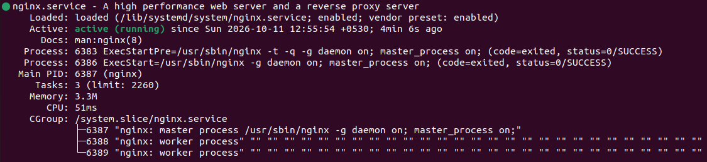
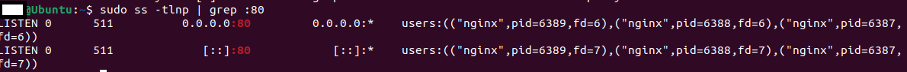
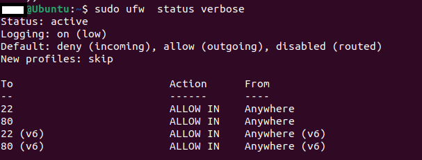
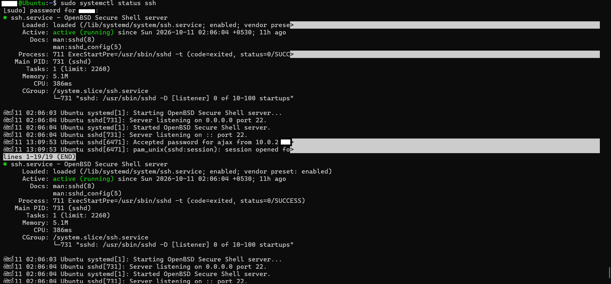
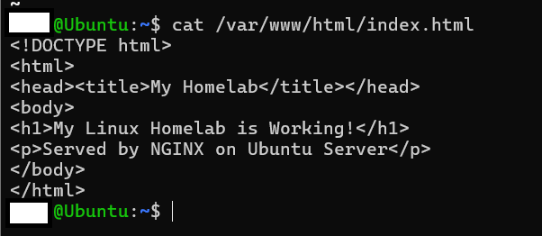
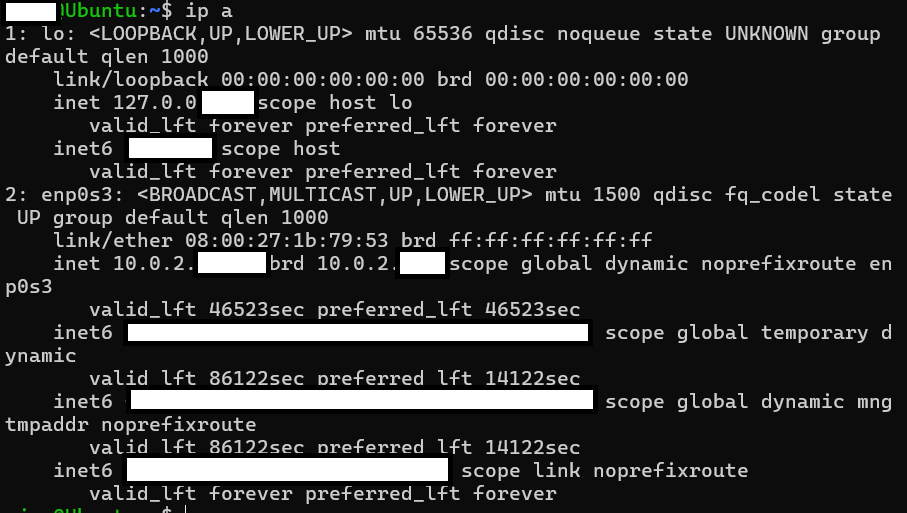
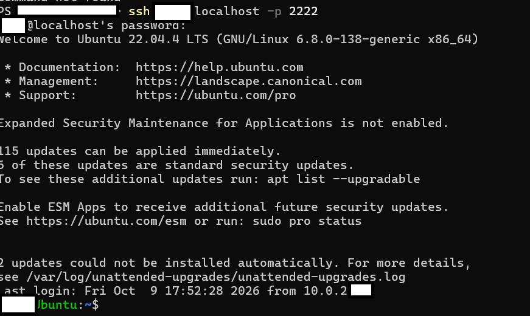
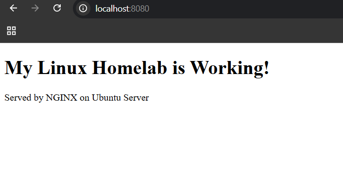

# Linux Homelab

A hands-on Linux homelab built on VirtualBox to practice systems administration, networking, and troubleshooting skills.

## Overview

I built this homelab to gain practical, hands-on experience with Linux systems administration, networking, and web server management. Instead of just reading tutorials, I configured everything from scratch, intentionally broke configurations to practice troubleshooting, and documented every step.

- **Host:** Windows 11 Laptop
- **Hypervisor:** VirtualBox
- **Guest OS:** Ubuntu Server 22.04 LTS
- **Networking:** NAT + Port Forwarding

## Architecture

- Windows 11 (Host)
  - VirtualBox
    - Ubuntu Server VM
      - SSH (Port 22)
      - NGINX (Port 80)
      - UFW Firewall
- Port Forwarding: Host 2222 to Guest 22 (SSH), Host 8080 to Guest 80 (HTTP)

## What I Built

### 1. Virtual Machine Setup
- Installed VirtualBox and created an Ubuntu Server VM
- Configured 2GB RAM, 20GB disk, NAT network

### 2. SSH Server
- Installed and enabled OpenSSH server
- Connected from Windows PowerShell via port forwarding

### 3. NAT Port Forwarding
- Created rules: Host 2222 to Guest 22 (SSH)
- Created rules: Host 8080 to Guest 80 (HTTP)

### 4. NGINX Web Server
- Installed NGINX and resolved a Port 80 conflict with Apache
- Deployed a custom HTML landing page
- Verified functionality via curl and browser

### 5. UFW Firewall
- Enabled UFW with default-deny incoming policy
- Allowed only Port 22 (SSH) and Port 80 (HTTP)
- Verified rules with `ufw status verbose`

### 6. Security Verification
- Confirmed MySQL, CUPS, and DNS services are bound to localhost only (127.0.0.1)
- Checked login history and failed attempts

## Screenshots

**NGINX Service Running**

**Port 80 Listening**

**UFW Firewall Rules**

**SSH Service Running**

**Custom HTML Page**

**Network Configuration**

**SSH Login from Windows**

**Browser Verification**

## Challenges and Solutions

### Challenge 1: Apache/NGINX Port 80 Conflict

**Problem:** NGINX failed to start after installation.

**Error:** `nginx: [emerg] still could not bind()`

**Diagnosis:** Ran `sudo ss -tlnp | grep :80` and found Apache was already listening on port 80.

**Solution:** Ran `sudo systemctl stop apache2`, then `sudo systemctl disable apache2`, then `sudo systemctl start nginx`.

**Lesson:** Only one service can bind to a port at a time.

### Challenge 2: NGINX Config Typo

**Problem:** Intentionally broke the NGINX config to practice troubleshooting.

**Error:** `invalid parameter "default_sever" in /etc/nginx/sites-enabled/default:22`

**Diagnosis:** Used `sudo nginx -t` to validate the config.

**Solution:** Ran `sudo sed -i 's/default_sever/default_server/' /etc/nginx/sites-enabled/default`, then `sudo nginx -t`, then `sudo systemctl restart nginx`.

**Lesson:** Always test config with `nginx -t` before restarting.

### Challenge 3: SSH Connection Timeout

**Problem:** Could not SSH from Windows to Ubuntu VM.

**Error:** `ssh: connect to host localhost port 22: Connection timed out`

**Root Cause:** VM on NAT network - IP not reachable from host without port forwarding.

**Solution:** Added VirtualBox port forwarding rule: Host 2222 to Guest 22.

**Lesson:** NAT isolates VMs from hosts. Port forwarding exposes services - similar to NAT gateways in cloud.

## Skills Demonstrated

- Linux CLI (navigation, permissions, process management)
- Networking (NAT, Port Forwarding, IP addressing)
- Service Management (systemd, systemctl)
- Web Server Administration (NGINX)
- Firewall Configuration (UFW)
- Troubleshooting (log analysis, config validation)
- Remote Server Management (SSH)
- Documentation and Knowledge Sharing

## Tools Used

| Category | Tools |
|----------|-------|
| Virtualization | VirtualBox |
| Operating System | Ubuntu Server 22.04 LTS |
| Web Server | NGINX |
| Firewall | UFW |
| Remote Access | OpenSSH |
| Host OS | Windows 11 |

## Custom HTML Page

The custom landing page at `/var/www/html/index.html` contains a simple HTML file with a heading "My Linux Homelab is Working!" and a paragraph "Served by NGINX on Ubuntu Server".

## Next Steps

- Automate setup with Ansible
- Add SSL/TLS with Let's Encrypt
- Deploy to AWS EC2
- Set up CI/CD with GitHub Actions
- Add monitoring with Prometheus/Grafana

## License

This project is for educational purposes.