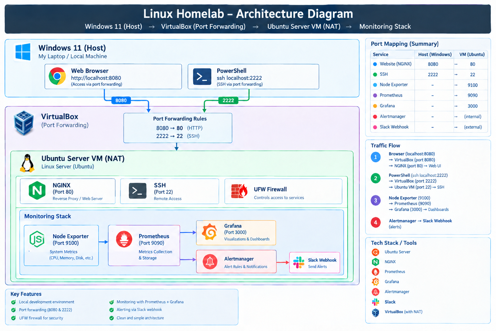
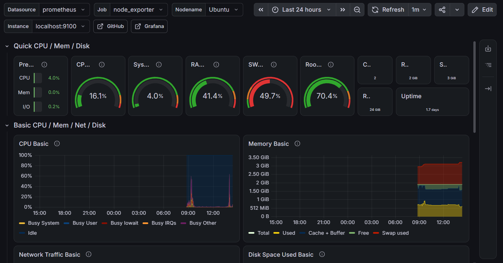
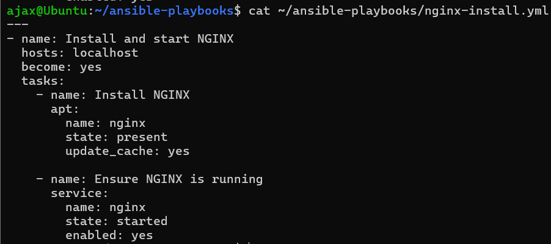
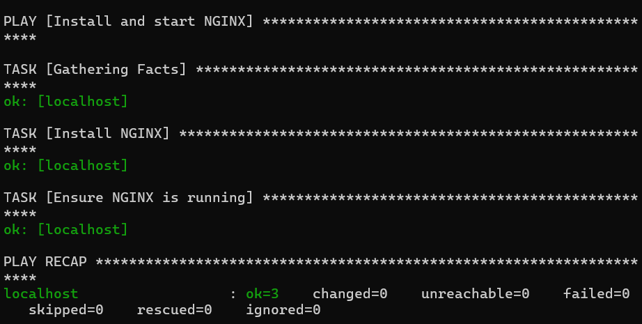
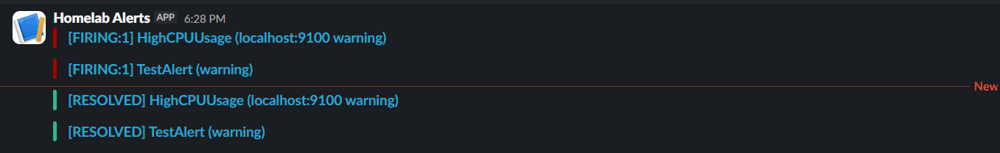
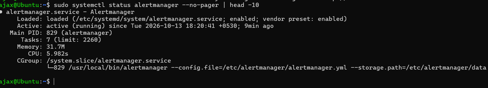

# Linux Homelab

A hands-on Linux homelab built on VirtualBox to practice systems administration, networking, and troubleshooting skills.

## Overview

I built this homelab to gain practical, hands-on experience with Linux systems administration, networking, and web server management. I configured everything from scratch, intentionally broke configurations to practice troubleshooting, and documented every step.

- **Host:** Windows 11 Laptop
- **Hypervisor:** VirtualBox
- **Guest OS:** Ubuntu Server 22.04 LTS
- **Networking:** NAT + Port Forwarding

## Architecture

## Step 1: Virtual Machine Setup

I installed VirtualBox on Windows and created a new Ubuntu Server VM with 2GB RAM, 2 CPU cores, 20GB disk, and a NAT network adapter.

## Step 2: SSH Server Setup

I installed OpenSSH server with `sudo apt install openssh-server -y`, then enabled and started the service.

## Step 3: NAT Port Forwarding

The VM is on a NAT network, so its IP is not directly reachable from Windows. I configured port forwarding in VirtualBox:

- Host 2222 to Guest 22 (SSH)
- Host 8080 to Guest 80 (HTTP)

Then connected from Windows PowerShell with `ssh ajax@localhost -p 2222`.

## Step 4: NGINX Web Server

I installed NGINX with `sudo apt install nginx -y`. It failed to start because Apache was already using port 80 (see Challenge 1). After resolving the conflict, I verified the listener with `sudo ss -tlnp | grep :80`.

## Step 5: Custom HTML Page

I replaced the default NGINX page at `/var/www/html/index.html` with a custom HTML landing page.

Accessed at `http://localhost:8080`:

## Step 6: UFW Firewall

I allowed SSH and HTTP traffic, then enabled UFW with a default-deny incoming policy:

`sudo ufw allow 22`

`sudo ufw allow 80`

`sudo ufw enable`

`sudo ufw status verbose`

## Step 7: Monitoring Stack

I set up a monitoring stack to track server health.

- **Node Exporter** exposes system metrics such as CPU, RAM, and disk usage on port 9100.
- **Prometheus** scrapes and stores those metrics on port 9090.
- **Grafana** visualizes the data in dashboards on port 3000.

## Step 8: Ansible Automation

I wrote an Ansible playbook to automate NGINX installation and service management.

Running the playbook:

The output shows `ok=3, changed=0`, indicating that the desired state was already achieved and no changes were required during that run.

## Step 9: Alerting with Alertmanager

I configured Alertmanager to send alerts to Slack when CPU usage exceeds 80%.

- A Prometheus rule triggers when CPU usage exceeds 80% for one minute.
- Alertmanager receives the alert and sends it to a Slack channel through a webhook.
- I verified alert delivery using a CPU load test and a manual test alert.

## Challenges and Solutions

### Challenge 1: Apache/NGINX Port 80 Conflict

**Problem:** NGINX failed to start after installation.

**Error:** `nginx: [emerg] still could not bind()`

**Diagnosis:** I ran `sudo ss -tlnp | grep :80` and found Apache was already listening on port 80.

**Solution:** I ran `sudo systemctl stop apache2`, then `sudo systemctl disable apache2`, followed by `sudo systemctl start nginx`.

**Lesson:** Two services cannot simultaneously bind to the same IP address and port using conflicting socket settings.

### Challenge 2: NGINX Config Typo

**Problem:** I intentionally introduced a typo in the NGINX configuration to practice troubleshooting.

**Error:** `invalid parameter "default_sever" in /etc/nginx/sites-available/default:22`

**Diagnosis:** I used `sudo nginx -t` to validate the configuration.

**Solution:** I ran `sudo sed -i 's/default_sever/default_server/' /etc/nginx/sites-available/default`, then `sudo nginx -t`, followed by `sudo systemctl restart nginx`.

**Lesson:** Validate configuration with `nginx -t` before restarting or reloading the service.

### Challenge 3: SSH Connection Timeout

**Problem:** I could not establish an SSH connection from Windows to the Ubuntu VM.

**Error:** `ssh: connect to host localhost port 22: Connection timed out`

**Root Cause:** The VM used NAT networking, and the host could not reach the guest's SSH service through `localhost:22` without a port-forwarding rule.

**Solution:** I added a VirtualBox port-forwarding rule mapping host port 2222 to guest port 22.

**Lesson:** NAT port forwarding allows selected services on a guest VM to be reached through configured host ports. This differs from an AWS NAT Gateway, which provides outbound connectivity for resources in private subnets.

## Skills Demonstrated

- Linux command-line operations, navigation, permissions, and process management
- Networking fundamentals, NAT, port forwarding, and IP addressing
- Service management using systemd and systemctl
- Web server administration with NGINX
- Firewall configuration using UFW
- Monitoring with Prometheus, Grafana, and Node Exporter
- Configuration management and automation with Ansible
- Troubleshooting through log analysis and configuration validation
- Remote server administration using SSH
- Technical documentation and knowledge sharing

## Tools Used

| Category | Tools |
|----------|-------|
| Virtualization | VirtualBox |
| Operating System | Ubuntu Server 22.04 LTS |
| Web Server | NGINX |
| Firewall | UFW |
| Monitoring | Prometheus, Grafana, Node Exporter |
| Alerting | Alertmanager, Slack |
| Automation | Ansible |
| Remote Access | OpenSSH |
| Host OS | Windows 11 |

## Custom HTML Page

The custom landing page at `/var/www/html/index.html` contains a simple HTML page with the heading "My Linux Homelab is Working!" and the paragraph "Served by NGINX on Ubuntu Server".

## Next Steps

- Add SSL/TLS using Let's Encrypt.
- Deploy the homelab workload to AWS EC2.
- Set up CI/CD with GitHub Actions.

## License

This project is for educational purposes.